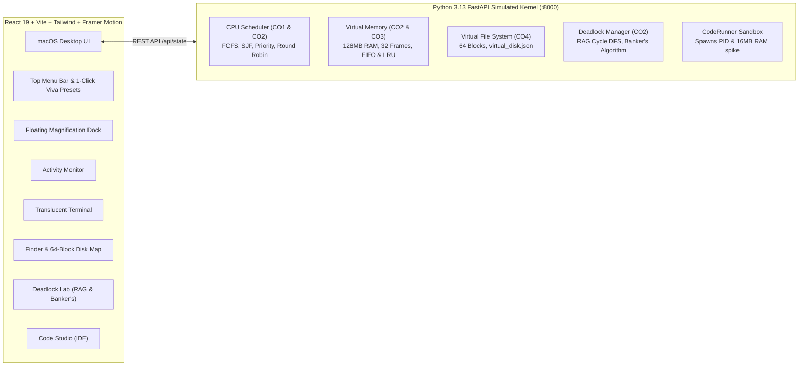

#  VayuOS — Mini-OS Desktop Environment

> **A high-fidelity macOS Sonoma/Sequoia aesthetic Desktop Operating System simulation with a real Python (FastAPI) OS Kernel backend and a modern React (Vite + Tailwind + Framer Motion) frontend.**

Built for Operating Systems laboratory demonstrations, project vivas, and interactive pedagogical exploration across **CO1, CO2, CO3, and CO4**.

---

## 🏗️ Architecture Overview



---

## 🎯 Course Outcomes (CO) Coverage for Viva

| Module | Course Outcome | Implementation Details | Where to View in GUI |
|---|---|---|---|
| **CPU Scheduler** | **CO1 & CO2** | Process Control Block (PCB) management, live switching between **FCFS**, **SJF (SRTF)**, **Priority**, and **Round Robin** (with configurable time quantum). Live Gantt chart strip. | **Activity Monitor** (CPU Tab) & **Terminal** (`algo`, `quantum`, `ps`) |
| **Virtual Memory & Paging** | **CO2 & CO3** | Simulates **128 MB Physical RAM** divided into **32 frames (4 MB each)**. Implements **FIFO** and **LRU** page replacement, real-time page faults & hits tracking, and swap history. | **Activity Monitor** (Memory Tab) |
| **Persistent File System** | **CO4** | Persists files to host disk `backend/virtual_disk.json`. Simulates a **64-block disk allocation table** supporting **Contiguous**, **Linked**, and **Indexed** visualization, permissions (`rwxr-xr-x`), and file CRUD. | **Finder** & **64-Block Disk Map View** |
| **Deadlock Management** | **CO2** | **Resource Allocation Graph (RAG)** with cycle detection (DFS), **Banker's Algorithm** safe sequence verification, circular wait deadlock presets, and **Auto-Recovery** (victim termination/preemption). | **Deadlock Lab** & **1-Click Viva Menu** |
| **Code Studio & Workloads** | **CO1, CO3, CO4** | Spawns temporary `CodeRunner` process in CPU Scheduler, allocates **16 MB RAM (4 frames)** for 3 seconds, safely executes Python script with captured output. | **Code Studio**, **Notes**, **Calculator** |

---

## 🚀 Execution Instructions

### 1. Start the Python OS Kernel Backend

In a terminal:

```bash
cd backend
pip install -r requirements.txt
python main.py
```
*The backend kernel starts at `http://127.0.0.1:8000`. You can inspect the interactive OpenAPI documentation at `http://127.0.0.1:8000/docs`.*

### 2. Start the React macOS Desktop Frontend

In a second terminal:

```bash
cd frontend
npm install
npm run dev
```
*Open `http://localhost:5173` in your browser.*

---

## 🌐 Cloud Deployment Guide (Free & 1-Click)

### Method 1: Render.com (Recommended — Unified Frontend + Backend in 1 Service)
1. Push your repository to **GitHub**.
2. Sign in to [Render.com](https://render.com) and click **"New +"** → **"Web Service"**.
3. Select your GitHub repository.
4. Set the following settings:
   - **Environment:** `Docker`
   - **Plan:** `Free`
5. Click **"Deploy Web Service"**!
Render will automatically build the React frontend into `dist/` and start the Python FastAPI Kernel. You will get a single live URL (e.g. `https://vayuos.onrender.com`) that serves the complete desktop!

### Method 2: Railway.app (Instant Deployment)
1. Push to GitHub and go to [Railway.app](https://railway.app).
2. Click **"New Project"** → **"Deploy from GitHub repo"**.
3. Railway automatically detects the `Dockerfile` and deploys both backend and frontend with live HTTPS!

### Method 3: Run with Docker Locally
```bash
docker build -t vayuos .
docker run -p 8000:8000 vayuos
```
Open `http://localhost:8000` in your browser.

---

## 🎓 1-Click Viva Demonstration Script

During your project demonstration or examiner viva, follow these quick steps:

1. **Verify Connection:**
   - Look at the top menu bar: verify the green glowing badge `Kernel Online` and live CPU & RAM usage pills.
2. **Demonstrate CPU Scheduling (CO1 & CO2):**
   - Open **Activity Monitor** from the Dock.
   - Switch between **FCFS**, **SJF**, **Priority**, and **Round Robin**. Adjust the Round Robin quantum to `2` and click **"Step Tick"** to observe clock cycles on the Gantt chart and PCB table.
3. **Trigger Page Replacement & Paging (CO2 & CO3):**
   - In Activity Monitor, switch to the **Memory & Paging** tab.
   - Click the **"1-Click Viva Demo"** button in the top menu bar and select **"Simulate Heavy Load"**.
   - Observe the 32-frame RAM grid light up, page faults increase, and FIFO/LRU eviction log entries appear!
4. **Demonstrate Deadlock & Banker's Algorithm (CO2):**
   - Open **Deadlock Lab** from the Dock.
   - Click **"Trigger Circular Wait Preset"**.
   - Watch the RAG graph nodes flash crimson red with the alert `DEADLOCK DETECTED (Circular Wait)`. Show the examiner how Banker's algorithm detects an `UNSAFE STATE`.
   - Click **"Auto-Recover"**: watch the victim process terminate, resources get freed, safe state restore, and confetti celebrate!
5. **Demonstrate Persistent File System (CO4):**
   - Open **Finder** from the Dock.
   - Click **"64-Block Disk Map"** on the left sidebar.
   - Toggle between **Contiguous**, **Linked**, and **Indexed** allocation strategies to show how blocks are chained or referenced by index blocks.
   - Create a file, edit its contents, save, and restart the backend: show that data persists in `backend/virtual_disk.json`.
6. **Demonstrate Code Studio Execution:**
   - Open **Code Studio** from the Dock.
   - Click **"Run Code"**: observe `CodeRunner` spawn in Activity Monitor, 16 MB of RAM (4 frames) allocate in real time, and the Python prime number output display in the bottom console!
7. **Demonstrate Terminal CLI:**
   - Open **Terminal** and run `help`, `ps`, `mem`, `ls`, `deadlock`, `banker`.

---

## 📁 Repository Structure

```
VayuOS/
├── backend/
│   ├── main.py              # FastAPI server, REST routes, background ticker
│   ├── scheduler.py         # CPU Scheduler, PCB, FCFS/SJF/Priority/RR, Gantt
│   ├── memory.py            # 128MB RAM, 32 Frames, FIFO/LRU Paging
│   ├── filesystem.py        # 64-Block Virtual Disk, Contiguous/Linked/Indexed
│   ├── deadlock.py          # Banker's Algorithm, RAG cycle detection, Auto-Recovery
│   ├── requirements.txt     # Python dependencies
│   └── virtual_disk.json    # Persistent file system storage
├── frontend/
│   ├── src/
│   │   ├── api/
│   │   │   └── kernelApi.js # Clean client connecting to Python Kernel
│   │   ├── components/
│   │   │   ├── MenuBar.jsx  # macOS top menu bar, status badge, viva dropdown
│   │   │   ├── Dock.jsx     # Floating magnification dock with spring physics
│   │   │   ├── Window.jsx   # Draggable glassmorphic window & traffic lights
│   │   │   ├── AboutModal.jsx# Viva reference guide & CO mapping modal
│   │   │   └── apps/
│   │   │       ├── ActivityMonitor.jsx # CPU scheduler & 32-frame RAM grid
│   │   │       ├── TerminalApp.jsx     # macOS translucent terminal
│   │   │       ├── FinderApp.jsx       # File browser & 64-block disk map
│   │   │       ├── DeadlockLab.jsx     # Interactive RAG graph & Banker's
│   │   │       ├── CodeStudio.jsx      # Dark IDE with safe Python runner
│   │   │       ├── NotesApp.jsx        # Notes app syncing to virtual disk
│   │   │       └── CalculatorApp.jsx   # Frosted glass calculator
│   │   ├── App.jsx          # Main desktop layout & state management
│   │   ├── index.css        # Glassmorphism & Tailwind styles
│   │   └── main.jsx
│   ├── package.json
│   └── vite.config.js
└── README.md
```

---

## 💡 Tech Stack

- **Backend:** Python 3.13, FastAPI, Uvicorn, Pydantic, Subprocess Sandbox
- **Frontend:** React 19, Vite 8, Tailwind CSS v4, Framer Motion, Lucide React, Canvas Confetti
- **Design:** Apple macOS Sonoma / Sequoia Glassmorphism (`backdrop-blur-2xl`, frosted glass borders, SF-inspired layout)
